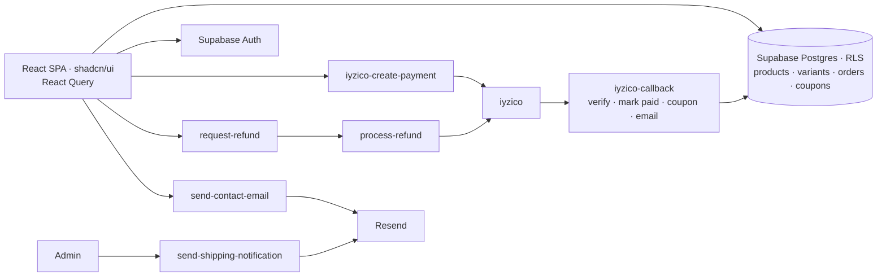

<div align="center">



<p>
  <a href="https://comicwall.vercel.app"></a>
  
  
  
</p>

<p><em>Turn your wall into a superpower. A store for comic-style art posters with the full shopping flow:<br>
catalogue, cart, wishlist, coupons, iyzico checkout, refunds, order tracking and an admin panel.</em></p>

</div>


## The idea

ComicWall sells original comic-style posters in Türkiye, so it has to do the unglamorous parts properly: lira prices per size, free shipping over a threshold, coupons, a Turkish card payment provider, the legal pages the law asks for, and an admin who can see what to ship today. The storefront is loud on purpose (halftone dots, bursts and bold colour); the plumbing underneath is careful.

> **Payment status comes from the provider, not the browser.** The checkout creates the payment in an Edge Function; iyzico calls another function back, which asks iyzico for the payment details by token, marks the order, counts the coupon use and sends the confirmation email before sending the customer to the success or failure page.


## Features

| | |
|---|---|
| **Catalogue** | Products and variants from Supabase, collections, fuzzy search with Fuse.js, filters and recently viewed items. |
| **Sizes and bundles** | 10×15, 13×18 and 20×30 cm, each with its own price (₺249, ₺379, ₺599), plus bundle prices for sets. |
| **Product page** | Large artwork, size picker, recently viewed and related posters. |
| **Cart and wishlist** | Persistent cart with coupon support; a wishlist for later. |
| **Shipping** | Free shipping from ₺750, ₺49 below it, with a progress bar toward free shipping. |
| **Coupons** | Percent, fixed amount or free shipping, managed in the admin. |
| **Checkout** | An address book with Turkish cities, then iyzico payment with success and failure pages. |
| **Orders and refunds** | Order history with tracking number and carrier; customers can request a refund and the admin processes it. |
| **Emails** | Order confirmation, shipping notification and the contact form, sent through Resend. |
| **Admin** | Dashboard (revenue, pending, today, low stock), products, orders with status and tracking, coupons. |
| **Legal pages** | Privacy, KVKK, terms, pre-information form, cookies, shipping and returns. |
| **TR / EN, dark and light** | A language context and theme switch; Vercel Analytics and optional Google Analytics. |


## How it fits together



| Edge Function | Does |
|---|---|
| `iyzico-create-payment` | Builds the iyzico checkout for the cart |
| `iyzico-callback` | Verifies the payment by token, updates the order, counts the coupon, emails the customer |
| `request-refund` · `process-refund` | The customer's request and the admin's refund through iyzico |
| `send-shipping-notification` | Emails the tracking number when an order ships |
| `send-contact-email` | Delivers the contact form |


## Pages

| Route | Page |
|---|---|
| `/` · `/shop` · `/collections` · `/collection/:slug` · `/product/:slug` | Storefront |
| `/cart` · `/checkout` · `/order-success` · `/order-failed` | Buying |
| `/login` · `/register` · `/profile` · `/orders` · `/wishlist` | Account |
| `/contact` · `/faq` · `/about` | Help |
| `/privacy` · `/kvkk` · `/terms` · `/pre-info` · `/cookies` · `/shipping-returns` | Legal |
| `/admin` · `/admin/products` · `/admin/orders` · `/admin/coupons` | Admin |


## Türkçe özet

**ComicWall**, çizgi roman tarzı sanat posterleri satan bir e-ticaret sitesi. Katalog, koleksiyonlar, bulanık arama, üç boy (10×15, 13×18, 20×30) ve set fiyatları, sepet, istek listesi, kuponlar (yüzde, sabit tutar, ücretsiz kargo), ₺750 üstü ücretsiz kargo, adres defteri, iyzico ile ödeme, iade talebi ve sipariş takibi var. Ödeme durumu tarayıcıdan değil, iyzico'nun geri çağrısından doğrulanıyor. Yönetici paneli gelir, bekleyen sipariş ve düşük stok gösteriyor; KVKK, ön bilgilendirme ve iade gibi yasal sayfalar hazır.


## Development

```sh
bun install          # or npm install
bun run dev          # Vite dev server
bun run build
bun run lint
```

The client reads `VITE_SUPABASE_URL`, `VITE_SUPABASE_PUBLISHABLE_KEY` and optionally `VITE_GA_ID`. The Edge Functions use `IYZICO_API_KEY`, `IYZICO_SECRET_KEY`, `IYZICO_BASE_URL`, `RESEND_API_KEY`, `ORDER_EMAIL_FROM`, `ORDER_EMAIL_ADMIN`, `CONTACT_EMAIL_FROM` and `CONTACT_EMAIL_TO`. `KURULUM.md` and `DEPLOY_CHECKLIST.md` walk through setup; `ROADMAP.md` lists what is next.

```
src/pages/            storefront, account, checkout, legal, admin
src/context/          cart, wishlist, auth, language
src/lib/              pricing (totals with coupons), shipping config, format
src/data/             sizes, prices, Turkish cities
supabase/functions/   iyzico, refunds, emails
supabase/migrations/  11 migrations
```

CI runs the type check, lint and build on pushes to `main` and on pull requests.

<div align="center">
<br>
<a href="https://github.com/kutluhangil"></a>
<sub>All rights reserved · the poster in the banner is an original placeholder.</sub>
</div>
