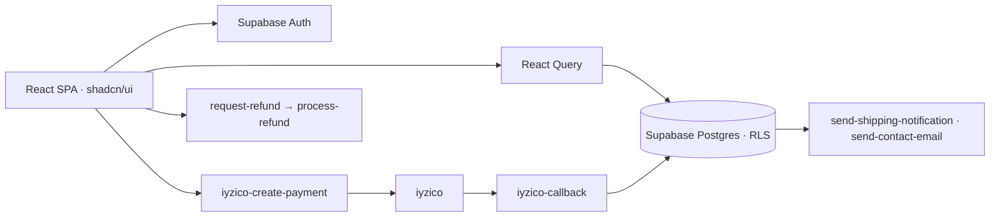

<div align="center">


<p>
  <a href="https://comicwall.vercel.app"></a>
  
  
  
</p>

<p><em>An e-commerce store for premium, comic-style art posters.<br>
A full shopping flow wrapped in punchy motion, built to turn a wall into a superpower.</em></p>

<a href="https://comicwall.vercel.app"></a>

</div>


## Features

| | |
|---|---|
| **Immersive UI** | Framer Motion animations, particle effects and a bold comic look. |
| **Shopping flow** | Catalogue, cart, wishlist, checkout and order history. |
| **Payments** | iyzico checkout with callbacks, plus refund requests and processing. |
| **Notifications** | Shipping and contact emails sent from Supabase Edge Functions. |
| **Accounts** | Sign-up, profiles and past orders on Supabase Auth. |
| **Themes and languages** | Dark and light modes, Turkish and English. |
| **Fast** | A Vite SPA with React Query caching. |


## How it fits together




## Türkçe özet

**ComicWall**, yüksek kaliteli çizgi roman tarzı posterler satan modern bir e-ticaret sitesi. Ürün kataloğu, sepet, favoriler, ödeme ve sipariş geçmişi tam bir alışveriş akışı olarak çalışıyor; ödemeler iyzico ile alınıyor, kargo ve iletişim e-postaları Supabase Edge Function'larından gidiyor. Açık/koyu tema ve Türkçe/İngilizce arayüzü var.


## Development

```sh
npm install
npm run dev       # http://localhost:8080
npm run build
supabase functions deploy   # payments, refunds and emails
```

```
src/pages/          shop, product, cart, checkout, orders, account, admin
src/components/     cards, galleries, cart drawer, effects
src/integrations/   Supabase client and types
supabase/           migrations and Edge Functions
```

<div align="center">
<br>
<a href="https://github.com/kutluhangil"></a>
<sub>Pow. Your wall just levelled up.</sub>
</div>
